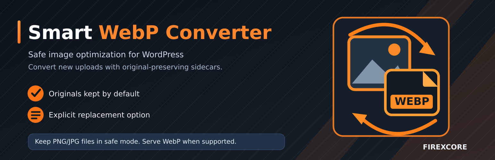

# Smart WebP Converter

**Image optimization for WordPress — safe WebP sidecars, optional original replacement, and conversion statistics.**



[**WordPress.org plugin page**](https://wordpress.org/plugins/smart-webp-converter/) · [**Download v1.2.1**](https://downloads.wordpress.org/plugin/smart-webp-converter.1.2.1.zip) · [**Published SVN tag**](https://plugins.svn.wordpress.org/smart-webp-converter/tags/1.2.1/) · [**Report an issue**](https://github.com/FireXCore/Smart-Webp-Converter/issues)

## Release status

| Item | Status |
| --- | --- |
| Public WordPress.org release | **1.2.1 — published** |
| Official plugin package | [`smart-webp-converter.1.2.1.zip`](https://downloads.wordpress.org/plugin/smart-webp-converter.1.2.1.zip) |
| WordPress.org source tag | [`tags/1.2.1`](https://plugins.svn.wordpress.org/smart-webp-converter/tags/1.2.1/) |
| Minimum requirements | WordPress 5.8+, PHP 7.4+ |
| Persian (fa_IR) translations | **68 / 68 submitted to Development GlotPress; 68 Waiting, 0 approved** at last check (2026-11-01) |
| Extended environments | WooCommerce, CDN/media offload, and multisite validation **not yet completed** |

**Publication was independently verified on 2026-11-01:** the WordPress.org SVN tag, plugin PHP and readme, administration stylesheet, all six marketing images, and the downloadable ZIP passed the [read-only release audit](https://github.com/FireXCore/Smart-Webp-Converter/actions/runs/41205983159).

GitHub is the **editable development source**. WordPress.org distributes the plugin from its separately maintained SVN repository; merging code here does **not** automatically publish a WordPress plugin update.

## How it works

**Default: keep the original.** When you upload a supported JPEG or PNG, the plugin creates a WebP file beside the original and its generated image sizes when server capabilities allow. WordPress Media Library continues to show the original `image/jpeg` or `image/png` file. Supported WordPress attachment image markup can serve WebP via `<picture>`, retaining the original as the fallback.

**Optional: replace the original.** You may enable destructive replacement for **future uploads** only, after explicitly confirming deletion in the settings. On successful conversion, the source file is removed and WordPress registers the new WebP file. **Keep this option off until you have verified backups and tested your media workflows.** The plugin cannot recover originals deleted in previous uploads.

### Included features

- WebP quality control; optional EXIF/IPTC/XMP removal and supported Imagick lossless mode.
- Real conversion statistics and responsive WordPress dashboard, without external JavaScript dependencies.
- Media Library conversion status and a single-attachment action to generate a missing WebP sidecar while keeping the original.
- Lazy-loading safeguards that respect existing WordPress image loading attributes.
- Optional filling of empty image alt text from meaningful attachment titles; existing alt text is preserved.
- Existing 1.1.0 settings and conversion statistics preserved during the tested upgrade path.

## Install

**For WordPress users:** use **Plugins → Add New** and search for **Smart WebP Converter**, or [download the official v1.2.1 package](https://downloads.wordpress.org/plugin/smart-webp-converter.1.2.1.zip) and upload it using **Plugins → Add New → Upload Plugin**.

**For contributors:** the editable plugin files are in [`smart-webp-converter/`](smart-webp-converter/). A source checkout can be packaged locally:

```sh
zip -r smart-webp-converter-1.2.1.zip smart-webp-converter/
```

Open **Smart WebP Converter → Settings**, keep **Replace Original** disabled, upload a JPG/PNG, and check **Media Library → WebP conversion** for the generated sidecar.

## Known limitations

- Animated GIFs are deliberately skipped to preserve animation; supported single-frame GIFs require Imagick.
- Existing attachments are **not** automatically bulk-converted on activation.
- Direct media URLs, site icons (including Apple touch icons), arbitrary HTML, and CSS background URLs are not rewritten.
- Image URLs served from an unrelated CDN/offload base may not receive automatic WebP `<picture>` sources; originals continue to work.
- Lossless conversion requires Imagick with WebP support; images above 40 million pixels are skipped.
- Legacy `webp-temp/` files are not automatically deleted or migrated.

See the [plugin readme](smart-webp-converter/readme.txt) for operational details and the [security audit](docs/SECURITY-AUDIT.md) for limitations and follow-up work.

## Tests and release evidence

The project CI validates PHP **7.4, 8.2 and 8.4**, WordPress **6.7.10 and 7.1.4**, real media conversion, and an upgrade from WordPress.org 1.1.0 that retains settings and historical statistics. Release workflows produce the installable plugin ZIP, WordPress.org asset previews, and packaging verification. These tests do not replace acceptance testing for every hosting or commerce configuration.

- [GitHub Actions](https://github.com/FireXCore/Smart-Webp-Converter/actions)
- [Release acceptance and outstanding compatibility checks](https://github.com/FireXCore/Smart-Webp-Converter/issues/2)

## Translations

The plugin uses the WordPress text domain `smart-webp-converter`.

- [Official translation project](https://translate.wordpress.org/projects/wp-plugins/smart-webp-converter/)
- [Persian — Development (trunk)](https://translate.wordpress.org/projects/wp-plugins/smart-webp-converter/dev/fa/default/)
- [Persian catalog draft (PO/POT) and translated readme](translations/)
- [Translation review and approval status](https://github.com/FireXCore/Smart-Webp-Converter/issues/10)

As of **2026-11-01**, all **68** Persian Development original strings had been submitted to GlotPress, but all were **Waiting** for human review and PTE/GTE approval; **none were Current**. Submission is not the same as an approved WordPress.org language pack. The Stable Readme translation also requires separate review.

## Licensing

The **published WordPress plugin** declares **GPL v2 or later** in its PHP header and WordPress.org readme. This GitHub repository still contains a historical **MIT [LICENSE](LICENSE)** file. The distinction is documented here and [tracked for maintainer review](https://github.com/FireXCore/Smart-Webp-Converter/issues/2); this README change does not relicense either distribution.
